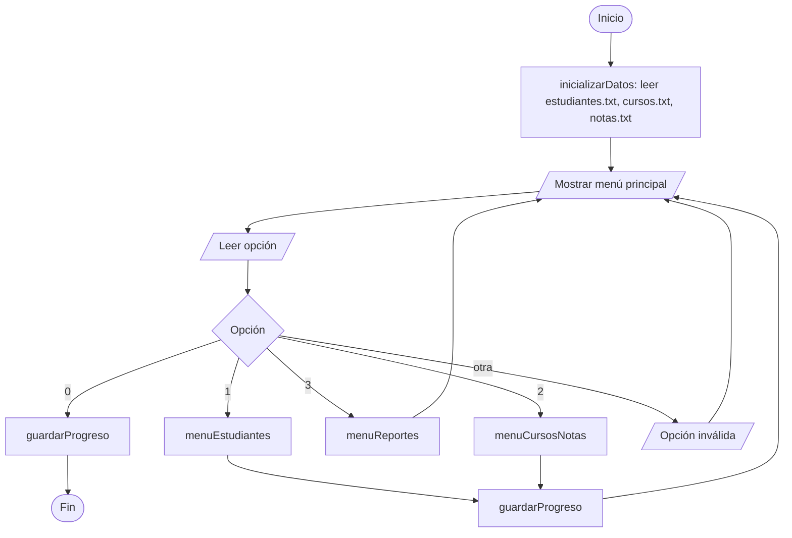
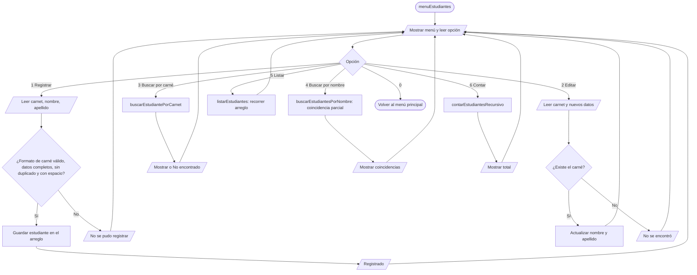
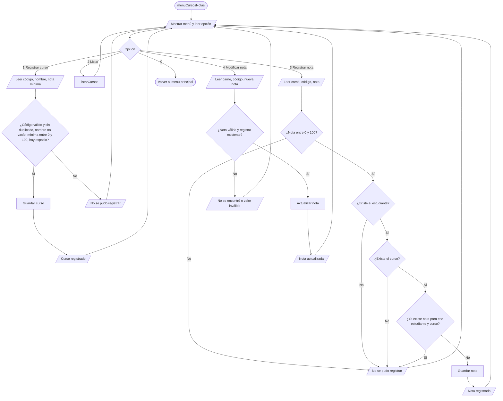
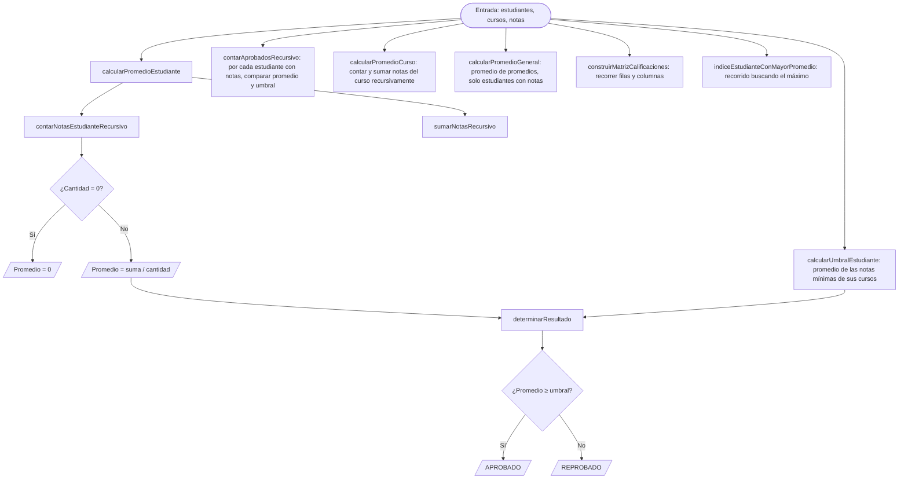
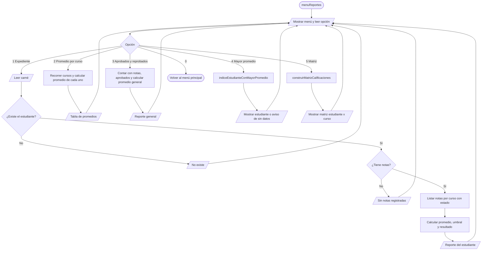
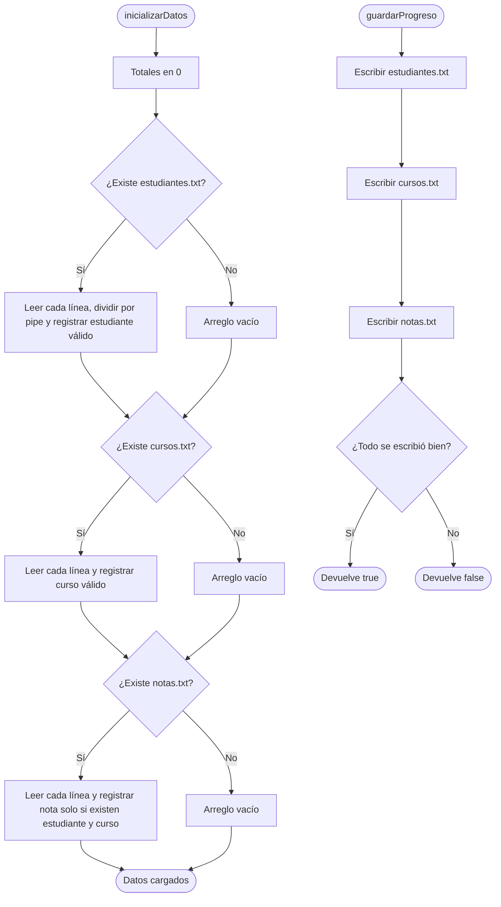

# Diagramas de flujo — Sistema de Control Académico

Los diagramas están en formato Mermaid. Se pueden ver en GitHub (se dibujan solos) o pegando el
código en https://mermaid.live para exportarlos como imagen y ponerlos en el informe.

## 1. Diagrama general (Main.cpp)

## 2. Módulo Estudiantes

## 3. Módulo Cursos y Notas

## 4. Módulo Procesamiento

## 5. Módulo Reportes

## 6. Módulo Persistencia

